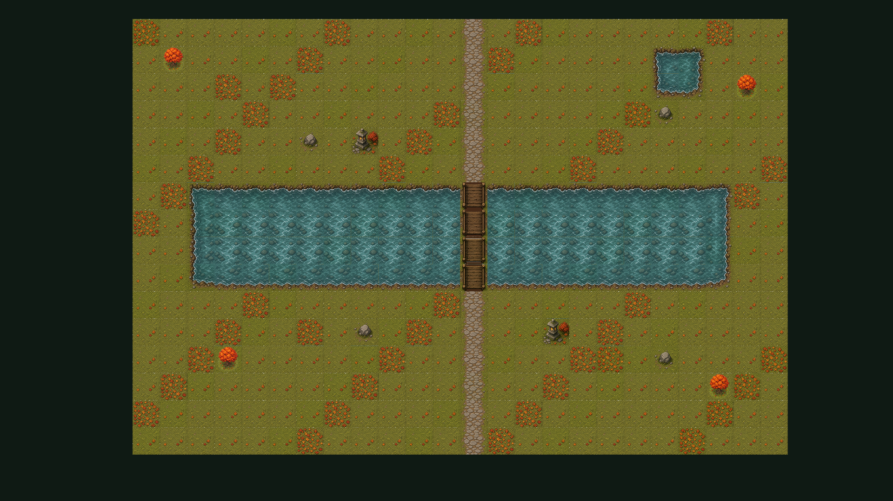
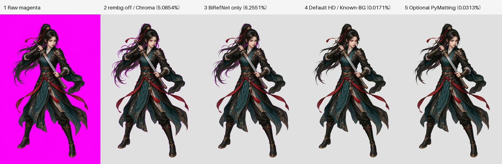
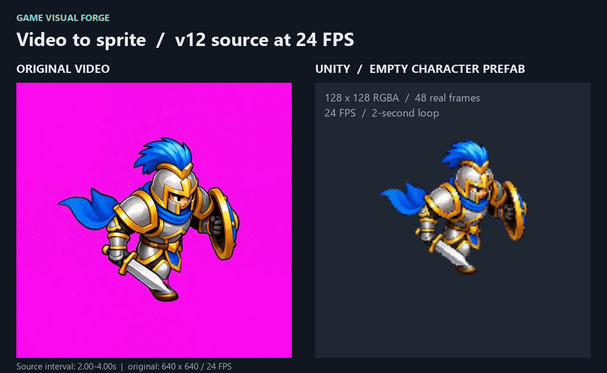
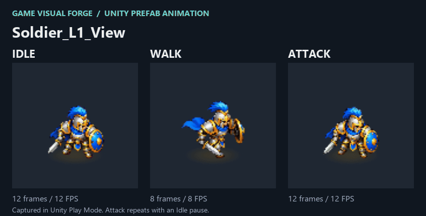
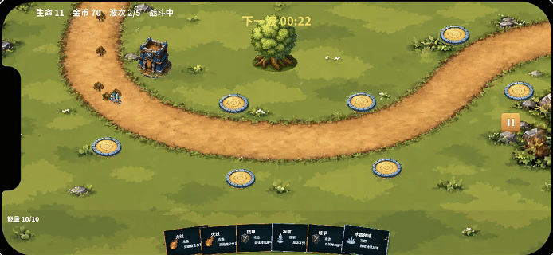
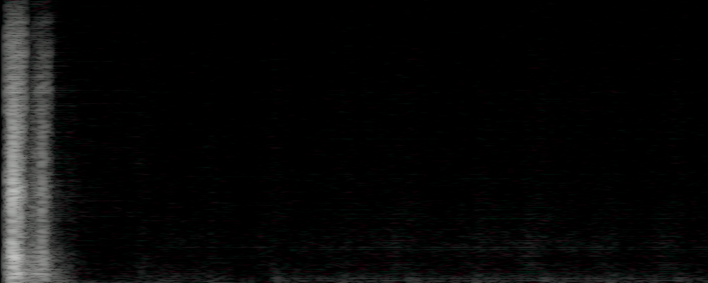

# Game Visual Forge

English | [简体中文](README.zh-CN.md)

**Game Visual Forge is a collection of Agent Skills for 2D game development**, covering the creation and delivery of maps, character sprites, animation frames, sound effects, and background music.

Describe what you need in natural language. The Agent assists with asset generation, background cleanup, sprite-sheet assembly, video frame extraction, and quality checks, producing transparent PNGs, animation sheets, GIF previews, map data, and WAV audio, with Unity import support.

Use the five skills independently or combine them into an asset production workflow. Image generation prioritizes the Agent's native tools, with external generation available through APIs, CLIs, and MCP integrations for platforms including MiniMax, Jimeng, and Wanxiang. Environment setup guidance is available when needed. Tool installation and paid generation require user confirmation.

## Skills

| Skill | Use it for | Typical output |
| --- | --- | --- |
| [`forge-2d-map`](skills/forge-2d-map/SKILL.md) | Playable 2D maps, Tilemaps, terrain, props, collision, and Unity handoff | Map bundle, preview, placement data, quality evidence |
| [`forge-2d-sprite`](skills/forge-2d-sprite/SKILL.md) | Characters, creatures, NPCs, props, effects, and animation sheets | Clean sprite sheets, frames, GIF previews, metadata |
| [`forge-video-to-sprite`](skills/forge-video-to-sprite/SKILL.md) | Turn existing, MiniMax Hailuo, Jimeng, or optional ComfyUI MiniMax H3 video into sprite frames. | Extracted frames, sprite strips, GIF previews, metadata |
| [`forge-text-audio`](skills/forge-text-audio/SKILL.md) | Explicitly requested SFX, UI sounds, action sounds, and ambience | Reviewed 44,100 Hz 16-bit PCM WAV and Unity AudioClip manifest |
| [`forge-game-music`](skills/forge-game-music/SKILL.md) | Game BGM, light music, looping beds, and strict instrumental tracks | Reviewed 44,100 Hz stereo WAV, music review, and optional Unity manifest |

## What it provides

- Natural-language intake with explicit choices for style, layout, runtime, and delivery format.
- Native Agent image tools take priority. When unavailable, choose MiniMax (recommended), Jimeng or Wanxiang through API, installed CLI or MCP. Tool installation requires user confirmation. [Provider setup](install/provider-tools.md)
- Python environment checks provide setup instructions for the current system and Agent assistance within the user's authorization. [Environment setup](install/python-environment.md)
- Deterministic local processing, validation reports, and reproducible output manifests.
- Playable map handoff with walkability, collision, objects, entrances, and Unity Tilemap support.
- Native map atlases are normalized to the declared grid, tile size, margins, and spacing before validation. This standardizes atlas geometry only; it does not repair artwork, seams, or map topology.
- Provider, cost, and submission confirmation gates for paid or external work.
- `forge-video-to-sprite` processes existing video locally with FFmpeg/FFprobe, timestamp sampling, rembg/Chroma cleanup, stable alignment, strips, sheets, GIF previews, and motion-quality evidence.
- Generated video routes support explicit existing, MiniMax Hailuo, Jimeng, or optional ComfyUI MiniMax H3 selection; tools and credentials are configured manually and never switched automatically.
- `forge-text-audio` uses the official local Stable Audio 3 `small-sfx` model through the isolated `stable-audio-3` runtime. It supports text-to-audio, redraw, inpaint, and continue modes, with WAV-only delivery and a final listening review.
- `forge-game-music` uses local Comfy Desktop MiniMax Music 3 by default; Stable Audio 3 is a documented cloud fallback and Suno remains gated until its official API schema and game terms are verified.

## Showcase




HD cleanup uses Pillow and NumPy/SciPy with rembg and the `birefnet-general` model. Optional PyMatting refines edges. Use `U2NET_HOME` for a shared model directory. The processor can fall back from CUDA to CPU, then to Chroma cleanup when needed.

```powershell
python -m pip install -e ".[image]"
python -m pip install -e ".[background]"
python -m pip install "rembg[cpu]"
python -m pip install "rembg[gpu]"
python -m pip install -e ".[matting]"
python -c "from rembg import new_session; new_session('birefnet-general')"
```

Choose the CPU or GPU rembg package for your environment. GPU requires a verified CUDA setup.

### Video to sprite

The walk comparison pairs seconds 2–4 of a local ComfyUI MiniMax H3 video with 48 extracted transparent frames at 128 × 128 and 24 FPS. The full 124-frame source took 116 seconds end to end. Nine other local runs averaged 67.6 seconds on an RTX 4070 Ti. [H3 community license](https://huggingface.co/MiniMaxAI/MiniMax-H3/blob/main/LICENSE) · [Timing and provenance](assets/readme/video-to-sprite-showcase-provenance.json)

[Original video](assets/readme/video-to-sprite-soldier-walk-v12-original.mp4) · [MP4 comparison](assets/readme/video-to-sprite-soldier-walk-v12-comparison.mp4)

Soldier Idle, Walk, and Attack retain their prefab anchors and animation references. The gameplay capture shows the animations on Soldier and both enemies in Tuanjie.

[Soldier animation MP4](assets/readme/video-to-sprite-soldier-l1-unity-actions.mp4)

[35-second gameplay MP4](assets/readme/video-to-sprite-tower-defense-gameplay.mp4)

### Audio samples

`forge-text-audio` produced the wooden UI click and hammer strikes locally with Stable Audio 3 Small-SFX.
[Wooden click WAV](assets/readme/stable-audio-3-small-sfx-wooden-ui-click.wav)


[Hammer WAV 1](assets/readme/stable-audio-3-small-sfx-blacksmith-hammer-01.wav) · [Hammer WAV 2](assets/readme/stable-audio-3-small-sfx-blacksmith-hammer-02.wav) · [Hammer WAV 3](assets/readme/stable-audio-3-small-sfx-blacksmith-hammer-03.wav)

The local Comfy Desktop MiniMax Music 3 example is 60 seconds of instrumental BGM, delivered as 44,100 Hz, 16-bit stereo WAV.
[WAV](assets/readme/minimax-music3-game-bgm-60s-clean-ending.wav) · [MP3](assets/readme/minimax-music3-game-bgm-60s-clean-ending.mp3) · [Final 5 seconds](assets/readme/minimax-music3-game-bgm-60s-final-5s.wav) · [Waveform](assets/readme/minimax-music3-game-bgm-60s-waveform.png) · [Provenance](assets/readme/minimax-music3-game-bgm-60s-provenance.json)

## Install

- [Unified installation guide](install/README.md)
- [统一安装指南（中文）](install/README.zh-CN.md)
- [Stable Audio 3 setup](install/stable-audio-3/README.md)
- [Comfy MCP official installation](https://docs.comfy.org/agent-tools/mcp#installation)
- [MiniMax H3 Prompt Writing Skill official installation](https://github.com/MiniMax-AI/MiniMax-H3/blob/main/skills/README.md#installation)

The unified guide contains both a copyable Agent request and the complete
manual installation flow. It installs the five core Forge Skills only.
Optional workflows are opt-in. The Agent asks whether to enable them, inspects
first, then asks again before installing missing components.

Provider setup stays separate from core Skill installation. Core installation
does not auto-install providers, FFmpeg, credentials, model weights, or
optional workflow dependencies.

To delegate the optional audio runtime setup to an Agent, copy this request:

> Install and configure the official stable-audio-3 runtime for forge-text-audio: ask me to choose the installation directory, keep the isolated Python environment, model weights, and all caches under that directory, require me to accept all licenses personally, never use a hosted API, run the repository's provider configure command without changing user environment variables or PATH, and finish by running and reporting the local offline preflight.

Detailed instructions are in [Stable Audio 3 setup](install/stable-audio-3/README.md). The ignored `game-visual-forge.local.json` stores only local paths; `provider configure` creates it. License acceptance remains a user action.

## Example requests

```text
Use forge-2d-map to create a top-down village with a north-south creek,
one walkable wooden bridge, building entrances, collision, and a Unity Tilemap.
```

```text
Use forge-2d-sprite to create a modern pixel-art player walk sheet with
transparent output and a preview GIF.
```

```text
Use forge-video-to-sprite with my existing MP4 and export a feet-aligned
24-frame sprite strip plus a preview GIF.
```

```text
Use forge-video-to-sprite with local ComfyUI MiniMax H3, optimize an I2VA
prompt from my first frame, then export aligned 16- and 32-frame sprite sheets.
```

```text
Use forge-text-audio to create three dry iron-sword impacts against a steel
shield, no music or voice, review the candidates, and prepare a Unity AudioClip.
```

For local video processing, install FFmpeg and FFprobe yourself. MiniMax Hailuo
API uses `MINIMAX_API_KEY`; Jimeng API uses `JIMENG_ACCESS_KEY` and
`JIMENG_SECRET_KEY`. The official `mmx` and `dreamina` CLIs are optional.

## Unity integration

The Tilemap package lives at
[`integrations/unity/com.game-visual-forge.tilemap`](integrations/unity/com.game-visual-forge.tilemap)
and imports validated Tilemap bundles into textures, Tiles, Palettes, and
Tilemap Prefabs. The independent audio package lives at
[`integrations/unity/com.game-visual-forge.audio`](integrations/unity/com.game-visual-forge.audio)
and imports reviewed WAV bundles as configured AudioClip assets without changing
scenes. Scene placement is performed through Unity MCP only after an explicit request.

## Repository layout

```text
skills/       Agent Skill instructions and launchers
src/          Shared contracts, routing, processing, and reports
integrations/ Unity Tilemap and audio packages plus tests
assets/       Small checked-in examples and showcase artifacts
install/      Unified installation and independent runtime guides
```

## Development check

Run the test suite from the repository root (the directory that contains `tests/`):

```powershell
Set-Location "game-visual-forge项目路径"
python -m unittest discover -s tests -q
```

## License

[MIT](LICENSE)
