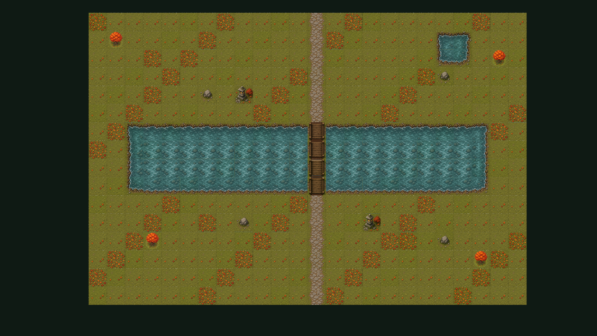
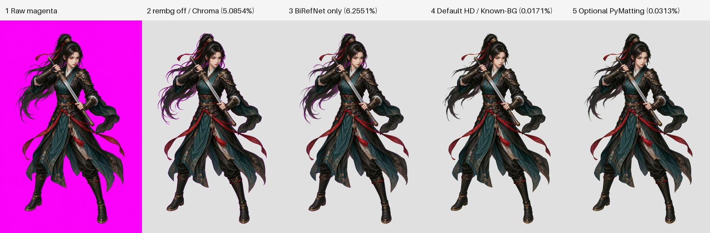
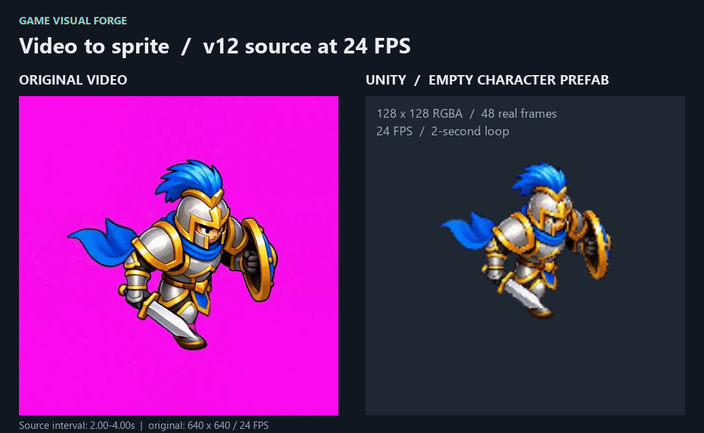
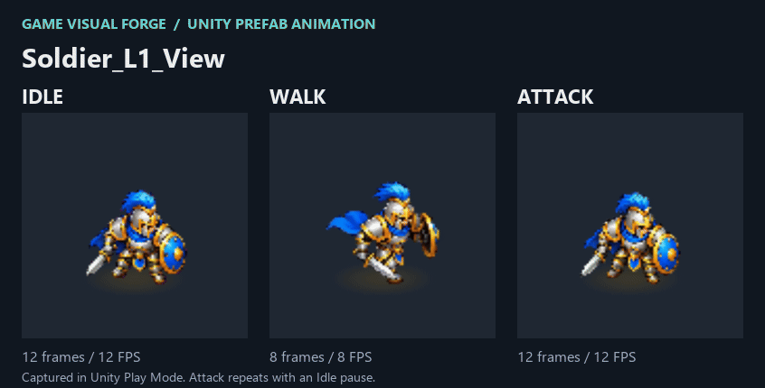
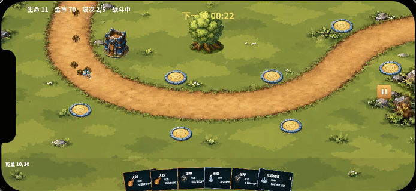
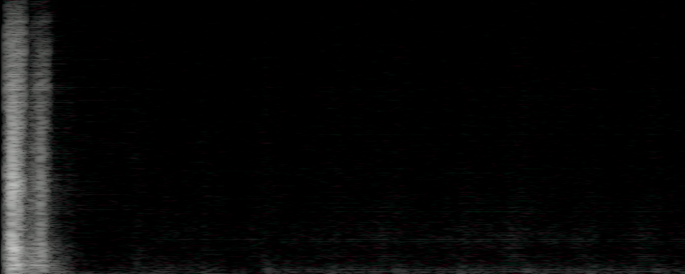

# Game Visual Forge

[English](README.md) | 简体中文

**Game Visual Forge 是面向 2D 游戏开发的 Agent Skills 集合**，涵盖地图、角色精灵、动画序列帧、音效和背景音乐的制作与交付。

用自然语言描述需求，由 Agent 协助完成素材生成、背景清理、图集整理、视频抽帧和质量检查，输出透明 PNG、动画图集、GIF 预览、地图数据及 WAV 音频，并提供 Unity 导入支持。

五个技能可以独立使用，也可组合完成素材制作流程。生图优先使用 Agent 自带能力，外部生成支持通过 API、CLI 和 MCP 接入 MiniMax、即梦、万相等平台。缺少运行环境时提供配置指引，工具安装与付费生成均由用户确认。

## Skills

| Skill | 用于 | 常见输出 |
| --- | --- | --- |
| [`forge-2d-map`](skills/forge-2d-map/SKILL.md) | 可行走的 2D 地图、Tilemap、地形、道具、碰撞和 Unity 交付 | 地图包、预览、放置数据、质量证据 |
| [`forge-2d-sprite`](skills/forge-2d-sprite/SKILL.md) | 角色、生物、NPC、道具、特效和动画图集 | 透明精灵图集、帧文件、GIF 预览、元数据 |
| [`forge-video-to-sprite`](skills/forge-video-to-sprite/SKILL.md) | 将现有或由海螺/MiniMax、即梦及可选 ComfyUI MiniMax H3 生成的视频转换为精灵帧。 | 抽帧、精灵条、GIF 预览、元数据 |
| [`forge-text-audio`](skills/forge-text-audio/SKILL.md) | 明确请求的 SFX、UI 音效、动作音效和环境音 | 审核后的 44,100 Hz 16-bit PCM WAV 与 Unity AudioClip 清单 |
| [`forge-game-music`](skills/forge-game-music/SKILL.md) | 游戏背景音乐、轻音乐、循环配乐和严格纯音乐 | 审核后的 44,100 Hz 立体声 WAV 与可选 Unity 清单 |

## 提供的能力

- 通过自然语言收集风格、布局、运行时和交付格式等关键选择。
- 优先使用 Agent 原生生图工具。不可用时由用户选择 MiniMax（推荐）、即梦或万相的 API、已安装 CLI 或 MCP 接入。安装工具需用户确认。[接入配置](install/provider-tools.md)
- 检查 Python 环境并提供适合当前系统的配置指引，Agent 可在用户授权范围内协助配置。[环境配置](install/python-environment.md)
- 使用确定性的本地处理、验证报告和可复现输出清单。
- 地图交付包含可行走区域、碰撞、对象、入口和 Unity Tilemap 支持。
- 原生图集会在验证前按声明的网格、Tile 尺寸、边距和间距标准化；这只统一图集几何，不修复画面、接缝或地图拓扑。
- 对付费或外部操作提供 Provider、费用和提交确认门槛。
- `forge-video-to-sprite` 使用 FFmpeg/FFprobe、本地时间戳抽帧、rembg/Chroma 清理、稳定对齐、图集、GIF 预览和运动质量证据处理现有视频。
- 视频生成支持明确选择现有、海螺/MiniMax、即梦或可选 ComfyUI MiniMax H3 路线；工具和凭据由用户手动配置，不会自动切换。
- `forge-text-audio` 使用隔离的官方 Stable Audio 3 `small-sfx` 本地运行时，支持 text-to-audio、redraw、inpaint 和 continue，只交付 WAV，并要求最终试听审核。
- `forge-game-music` 默认使用 Comfy Desktop MiniMax Music 3；Stable Audio 3 是有官方资料的云端备用，Suno 在官方 API 字段和游戏商用条款核验前保持门禁。

## 展示




高清抠图使用 Pillow、NumPy/SciPy 和 rembg 的 `birefnet-general` 模型，也可用 PyMatting 细化边缘。通过 `REMBG_HOME` 或旧版的 `U2NET_HOME` 指定共享模型缓存。处理器支持 CUDA、CPU 和 Chroma 清理回退。

本地图像处理以及使用 Preserve 或 Chroma 的视频处理需要图像依赖。

```powershell
python -m pip install -e ".[image]"
```

使用 rembg 时，安装抠图依赖并选择一种 ONNX Runtime 后端。GPU 版需要可用的 CUDA 环境。

```powershell
python -m pip install -e ".[background]"
```

使用 CPU 时运行 `python -m pip install "rembg[cpu]"`，
使用 CUDA 时运行 `python -m pip install "rembg[gpu]"`。

需要 PyMatting 细化时，在同一个环境安装细化依赖。准备好下载后再预缓存模型。

```powershell
python -m pip install -e ".[matting]"
python -c "from rembg import new_session; new_session('birefnet-general')"
```

### 视频转精灵

行走对照展示本地 ComfyUI MiniMax H3 视频的第 2–4 秒，以及从同一片段提取的 48 张 128 × 128 透明帧，按 24 FPS 播放。完整的 124 帧原片从提交到完成耗时 116 秒。同一台 RTX 4070 Ti 上的另 9 次本地生成平均耗时 67.6 秒。[H3 社区许可](https://huggingface.co/MiniMaxAI/MiniMax-H3/blob/main/LICENSE) · [计时与来源](assets/readme/video-to-sprite-showcase-provenance.json)

[原视频](assets/readme/video-to-sprite-soldier-walk-v12-original.mp4) · [MP4 对照](assets/readme/video-to-sprite-soldier-walk-v12-comparison.mp4)

Soldier 的待机、行走和攻击动作沿用预制体的锚点和动画引用。运行录屏展示了 Soldier 和两种敌人在团结编辑器里的动作。

[Soldier 动作 MP4](assets/readme/video-to-sprite-soldier-l1-unity-actions.mp4)

[35 秒运行效果 MP4](assets/readme/video-to-sprite-tower-defense-gameplay.mp4)

### 音频示例

`forge-text-audio` 通过本地 Stable Audio 3 Small-SFX 生成木质点击和打铁音效。
[木质点击 WAV](assets/readme/stable-audio-3-small-sfx-wooden-ui-click.wav)


[打铁 WAV 1](assets/readme/stable-audio-3-small-sfx-blacksmith-hammer-01.wav) · [打铁 WAV 2](assets/readme/stable-audio-3-small-sfx-blacksmith-hammer-02.wav) · [打铁 WAV 3](assets/readme/stable-audio-3-small-sfx-blacksmith-hammer-03.wav)

本地 Comfy Desktop MiniMax Music 3 样例为 60 秒纯音乐，交付 WAV 为 44,100 Hz、16-bit 立体声。
[WAV](assets/readme/minimax-music3-game-bgm-60s-clean-ending.wav) · [MP3](assets/readme/minimax-music3-game-bgm-60s-clean-ending.mp3) · [最后 5 秒](assets/readme/minimax-music3-game-bgm-60s-final-5s.wav) · [波形](assets/readme/minimax-music3-game-bgm-60s-waveform.png) · [来源](assets/readme/minimax-music3-game-bgm-60s-provenance.json)

## 安装

- [统一安装指南](install/README.zh-CN.md)
- [统一安装指南英文版](install/README.md)
- [Stable Audio 3 安装指南](install/stable-audio-3/README.zh-CN.md)
- [Comfy MCP 官方安装说明](https://docs.comfy.org/agent-tools/mcp#installation)
- [MiniMax H3 Prompt Writing Skill 官方安装说明](https://github.com/MiniMax-AI/MiniMax-H3/blob/main/skills/README.md#installation)

统一指南同时包含可复制给 Agent 的请求和完整手动安装流程。核心流程只安装五个 Forge Skills。可选工作流必须由用户主动选择启用；Agent 会先询问是否启用，先检查，
再在安装缺失组件前二次确认。

Provider 配置与核心 Skill 安装分开处理。核心安装不会自动安装 Provider、
FFmpeg、凭据、模型权重或可选工作流依赖。

需要 Agent 安装音效运行时时，复制下面这句话：

> 请为 forge-text-audio 安装并配置官方 stable-audio-3：先询问我安装目录，将独立 Python 环境、模型和全部缓存放入该目录；许可证必须由我本人确认，禁止调用托管 API；安装完成后在 game-visual-forge 仓库中运行 provider configure 命令创建本地配置，不修改用户环境变量或 PATH，最后运行离线预检并报告结果。

详细说明见 [Stable Audio 3 安装指南](install/stable-audio-3/README.zh-CN.md)。`provider configure` 会创建只保存本地路径的 `game-visual-forge.local.json`。

## 请求示例

```text
使用 forge-2d-map 制作俯视角村落：南北向小溪、一座可通行木桥、建筑入口、碰撞和 Unity Tilemap。
```

```text
使用 forge-2d-sprite 制作现代像素风玩家行走图，输出透明图集和 GIF 预览。
```

```text
使用 forge-video-to-sprite 处理我提供的 MP4，导出脚部对齐的 24 帧精灵条和 GIF 预览。
```

```text
使用 forge-video-to-sprite 和本地 ComfyUI MiniMax H3，从我的首帧图优化 I2VA
提示词，然后导出对齐的 16 帧与 32 帧精灵图集。
```

```text
使用 forge-text-audio 制作三组干燥的铁剑击中钢盾音效，不要音乐或人声，审核候选并准备 Unity AudioClip。
```

本地视频处理需要手动安装 FFmpeg 和 FFprobe。海螺/MiniMax API 使用
`MINIMAX_API_KEY`；即梦 API 使用 `JIMENG_ACCESS_KEY` 和
`JIMENG_SECRET_KEY`；官方 `mmx` 与 `dreamina` CLI 是可选项。

## Unity 集成

Tilemap 包位于
[`integrations/unity/com.game-visual-forge.tilemap`](integrations/unity/com.game-visual-forge.tilemap)，
负责将已验证地图包导入纹理、Tiles、Palette 和 Tilemap Prefab。独立的音频包位于
[`integrations/unity/com.game-visual-forge.audio`](integrations/unity/com.game-visual-forge.audio)，
负责导入审核后的 WAV 和配置 AudioClip，不修改场景。只有用户明确要求时，才通过 Unity MCP 放置场景对象。

## 仓库结构

```text
skills/       Agent Skill 说明和启动器
src/          共享合同、路由、处理和报告
integrations/ Unity Tilemap 与音频包及测试
assets/       小型示例和展示素材
install/      统一安装与独立运行时指南
```

## 开发检查

请在包含 `tests/` 的仓库根目录运行：

```powershell
Set-Location "game-visual-forge项目路径"
python -m pip install -e ".[test]"
python -m unittest discover -s tests -q
```

工作流命令将结果以 JSON 写入 stdout。命令行参数错误以 JSON 写入 stderr，退出码为 2。其他失败以 JSON 写入 stderr，退出码为 1。可通过 `error.code` 判断请求、依赖、I/O、Provider、处理或内部错误。

## 许可证

[MIT](LICENSE)
